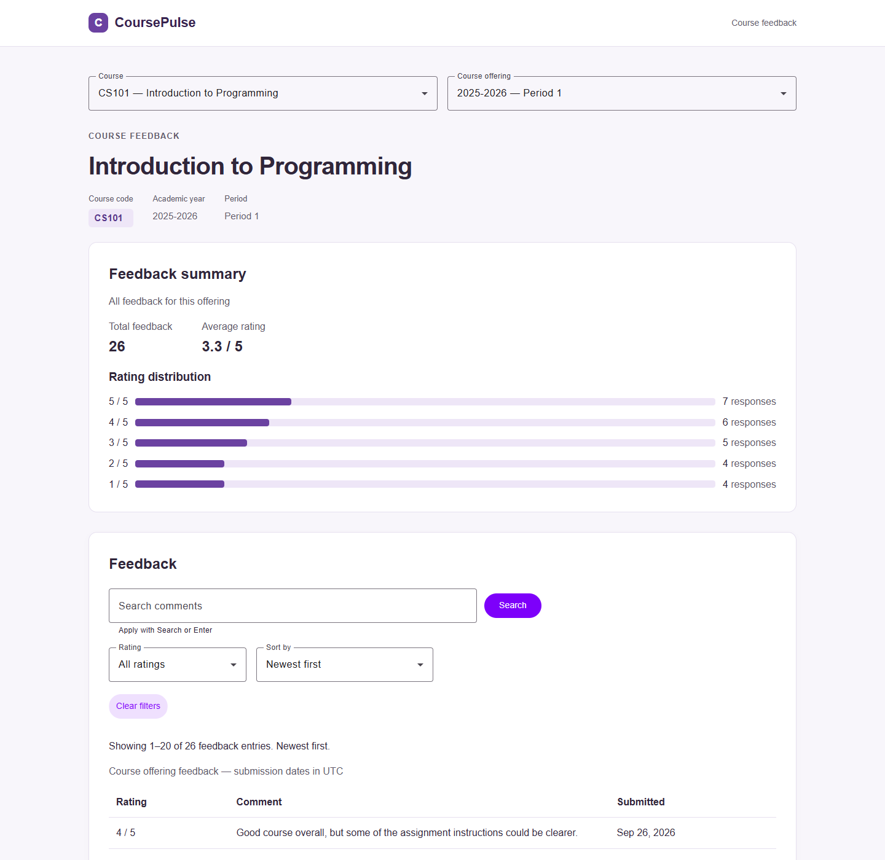
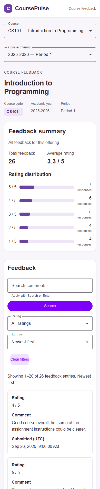

# CoursePulse

A course feedback viewer for teachers and course coordinators. Compare course
offerings, review rating summaries, and search, filter, sort and page through
comments. The summary always covers the entire offering; filters affect the list.

Built with Angular 22 / Material, Java 26 / Spring Boot 4.1.1, PostgreSQL 17
and Flyway.



<details>
<summary>Mobile view</summary>



</details>

## Run the demo

Requires Docker with the Compose plugin and a running Linux container engine
(Docker Desktop on Windows). From the repository root:

```sh
docker compose --env-file .env.example -f compose.demo.yml up --build -d --wait --wait-timeout 180
```

Open [http://127.0.0.1:18080/feedback](http://127.0.0.1:18080/feedback).
The first build needs internet access; Java and Node.js run inside the images.
The demo database is separate from the development database and persists between
runs. See [Docker instructions](DOCKER.md) for stopping, logs, updates and port changes.

Try CS101 / 2025–2026: browse its 26 entries, search for `exercises`, filter by
rating and change the sort order. Switch to 2026–2027 to see 3 entries averaging
4.0 / 5. Refresh the page or try a mobile viewport.

## Checks

For local checks, install Node.js 24.22.1+ (24.x) and JDK 26; keep Docker running
for backend Testcontainers tests. In `frontend/`:

```sh
npm ci
npm run lint
npm test -- --watch=false
npm run build
```

In `backend/`: `./gradlew.bat test` (Windows) or `bash ./gradlew test` (macOS/Linux).